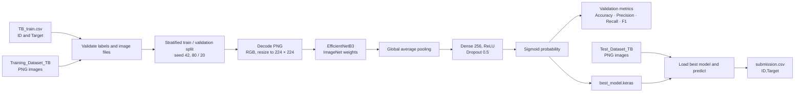
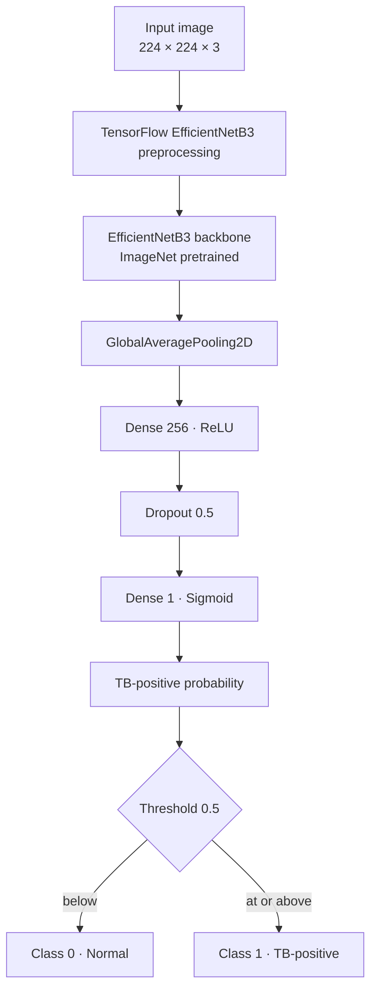
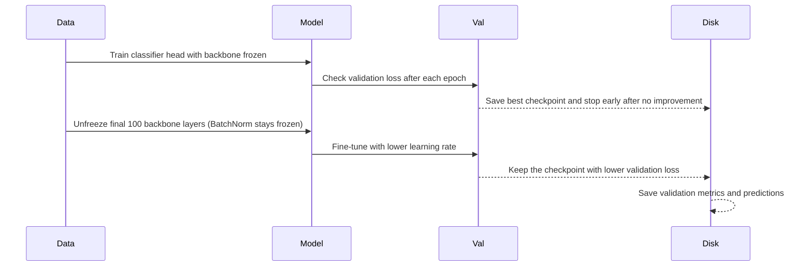

<div align="center">


### Chest X-ray Tuberculosis Classification

**A transfer-learning project built for the CDIS, IIT Kanpur AI/ML hackathon**


[Overview](#overview) · [Architecture](#how-it-works) · [Setup](#quick-start) · [Docs](#project-documentation) · [Competition](#competition-context)

</div>

---

> **Project status:** The repository contains the original Colab notebooks and a maintained command-line pipeline. A local dataset copy was still incomplete at the latest check, so no clean pipeline run or PulmoScan performance result is available. Kaggle CLI inspection found no submissions for the connected account. The notebooks contain training code, but no saved successful model or generated submission; two copies retain an old `KeyError: 'class'` output in an otherwise empty cell.

## Overview

PulmoScan explores whether transfer learning can classify a chest X-ray as **normal** or **TB-positive**. It uses an ImageNet-pretrained EfficientNetB3 convolutional neural network, a small binary classification head, and a two-stage training plan: first train the head while the backbone is frozen, then optionally fine-tune its final layers.

The project began as a short AI/ML hackathon effort. This repository makes the work easier to understand and reproduce by preserving the original notebooks, separating the runnable pipeline into Python modules, documenting the source material, and making the current evidence and limitations explicit.

### At a glance

| Item | Details |
|---|---|
| Problem | Binary chest X-ray image classification |
| Positive class | `1` = TB-positive |
| Negative class | `0` = normal |
| Backbone | EfficientNetB3, ImageNet weights |
| Input size | 224 × 224 RGB |
| Training plan | Frozen-backbone head training, followed by optional fine-tuning |
| Competition | Tuberculosis Detection from Chest X-Rays, attributed in supplied notes to CDIS, IIT Kanpur |
| Current evidence | Original notebooks, source notes, local labels and test images; no verified PulmoScan result |

### What this repository provides

- A data loader that validates labels, duplicate IDs and image paths before training.
- A reproducible stratified holdout split using a fixed random seed.
- An EfficientNetB3 model builder and two-phase training routine.
- Validation metrics and per-image probabilities saved as run artifacts.
- A test inference command that writes `ID,Target` predictions.
- A model card, architecture notes, training guide and competition provenance.
- The original Colab notebooks retained as historical project artifacts.

## How it works



### Model architecture



EfficientNet preprocessing is built into the TensorFlow/Keras application model. The maintained pipeline therefore feeds resized image values directly to the model; it does not apply the notebook's additional `/255` scaling step.

### Training stages



## Quick start

Use Python 3.10 or 3.11 in Linux, WSL2, or Google Colab. TensorFlow 2.16 does not support native Windows training. A Linux or Colab GPU runtime is recommended for training. The first model build may need network access to download pretrained ImageNet weights.

```bash
python3.11 -m venv .venv
source .venv/bin/activate
python -m pip install --upgrade pip
pip install -e .
```

Put the competition files in the following layout (or supply custom paths to the CLI):

```text
TB_Dataset/
├── TB_train.csv
├── Training_Dataset_TB/
│   ├── TB_train_0001.png
│   └── ...
└── Test_Dataset_TB/
    ├── TB_test_0001.png
    └── ...
```

Train and evaluate, then create test predictions:

```bash
python -m pulmoscan train \
  --data-dir TB_Dataset \
  --output-dir artifacts/run-001

python -m pulmoscan predict \
  --model artifacts/run-001/best_model.keras \
  --data-dir TB_Dataset \
  --output artifacts/run-001/submission.csv
```

Use `python -m pulmoscan train --help` or `python -m pulmoscan predict --help` to see all command options. In WSL2, keep the dataset under the repository's mounted drive or pass an absolute path with `--data-dir`.

## Method and defaults

| Setting | Default | Purpose |
|---|---:|---|
| Backbone | EfficientNetB3 | ImageNet pretrained feature extractor |
| Input image size | 224 × 224 | Resize every decoded PNG to a consistent shape |
| Batch size | 32 | Number of images per training batch |
| Validation fraction | 0.20 | Stratified holdout from labeled images |
| Random seed | 42 | Reproducible split and training initialization |
| Head epochs | 10 | Train new classification head with frozen backbone |
| Fine-tuning epochs | 10 | Continue through the final backbone layers |
| Head learning rate | `1e-4` | Adam learning rate for frozen-backbone stage |
| Fine-tuning learning rate | `1e-5` | Lower Adam learning rate for fine-tuning |
| Fine-tuned layers | 100 | Last backbone layers eligible for training |
| Dropout | 0.5 | Regularization before the output layer |
| Loss | Binary cross-entropy | Binary classification objective |
| Decision threshold | 0.5 | Convert probability into output label |

The command-line flags can override these values. Early stopping monitors validation loss with patience 3, and model checkpoints retain the best validation-loss model. Batch-normalization layers remain frozen during fine-tuning. These implementation details are part of the maintained pipeline; the original notebook does not contain all of these safeguards.

## Data and labels

The CSV format is:

```csv
ID,Target
TB_train_0001.png,0
TB_train_0002.png,1
```

`ID` must match a file in the training image directory. `Target` must be `0` or `1`. The source notes describe 2,940 labeled rows and 1,260 test images; the local CSV observed during setup had 2,450 class-0 labels and 490 class-1 labels. At the last setup check, only 1,309 of the 2,940 labeled training images were present, so that copy was incomplete. The loader reports missing files and stops instead of silently omitting records.

See [the data guide](docs/data.md) for data provenance, expected layout, validation behavior and access notes.

## Evaluation and outputs

After a completed training run, the pipeline calculates the following on the holdout validation split:

| Metric | Interpretation |
|---|---|
| Accuracy | Fraction of validation images classified correctly |
| Precision | Fraction of predicted TB-positive images that are positive in the labels |
| Recall | Fraction of labeled TB-positive images detected by the model |
| F1 | Harmonic mean of precision and recall |

It saves these files in the selected output directory:

| File | Contents |
|---|---|
| `best_model.keras` | Saved model checkpoint with the lowest validation loss |
| `validation_metrics.json` | Metrics, split counts, threshold and run configuration |
| `validation_predictions.csv` | Validation IDs, ground-truth labels, probabilities and predicted labels |
| `submission.csv` | Test image IDs and predicted binary labels (created by `predict`) |

No validation metric or Kaggle score is included in this repository because the available dataset copy has not been complete for a full pipeline run.

## Project documentation

| Document | Description |
|---|---|
| [Architecture](docs/architecture.md) | Component responsibilities and data flow |
| [Training guide](docs/training.md) | Training phases, callbacks, metrics and run artifacts |
| [Data guide](docs/data.md) | Dataset layout, validation and copy status |
| [Competition provenance](docs/competition.md) | Supplied details versus Kaggle account/API checks |
| [Results and evidence](docs/results.md) | What has and has not been measured |
| [Model card](docs/model-card.md) | Intended use, limitations and risk notes |
| [Notebook archive](notebooks/README.md) | Context on the original Colab notebooks |
| [Contributing](CONTRIBUTING.md) | How to extend the repository |

## Repository structure

```text
PulmoScan-TB-Detection/
├── README.md
├── CONTRIBUTING.md
├── CHANGELOG.md
├── pyproject.toml
├── requirements.txt
├── assets/
│   └── pulmoscan-logo.svg
├── docs/
│   ├── architecture.md
│   ├── competition.md
│   ├── data.md
│   ├── model-card.md
│   ├── roadmap.md
│   ├── results.md
│   ├── training.md
│   └── source-materials/
├── notebooks/
│   ├── README.md
│   └── original/
├── src/pulmoscan/
│   ├── cli.py
│   ├── data.py
│   ├── model.py
│   ├── predict.py
│   └── train.py
├── artifacts/             # Local run outputs
└── TB_Dataset/            # Local competition data
```

The data directory is separate from the Python package. Confirm the competition's data-use terms and the size of the image files before adding any dataset files to a public repository.

## Competition context

The supplied project notes attribute the **Tuberculosis Detection from Chest X-Rays** event to CDIS, IIT Kanpur and link to the [Kaggle competition page](https://www.kaggle.com/competitions/tuberculosis-detection-from-chest-x-rays). The notes list March 28–30, 2025 and F1 with recall as a tie-breaker; these details have not been fully confirmed against accessible official rules. During repository setup, Kaggle CLI access showed public leaderboard entries, no submissions for the connected account, and only a `nothing.txt` placeholder in the competition file listing. Full provenance is in [competition notes](docs/competition.md).

## Responsible use

PulmoScan is an educational machine-learning project. It is not a medical device, is not clinically validated, and must not be used to diagnose, screen, triage or treat anyone. A model prediction is not a medical finding. Read the [model card](docs/model-card.md) before interpreting the outputs.

## Acknowledgements

The competition attribution and initial modeling approach come from the materials supplied with this project. EfficientNetB3 pretrained weights are distributed through TensorFlow/Keras Applications and remain subject to the applicable upstream terms.
