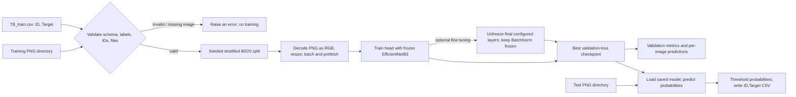
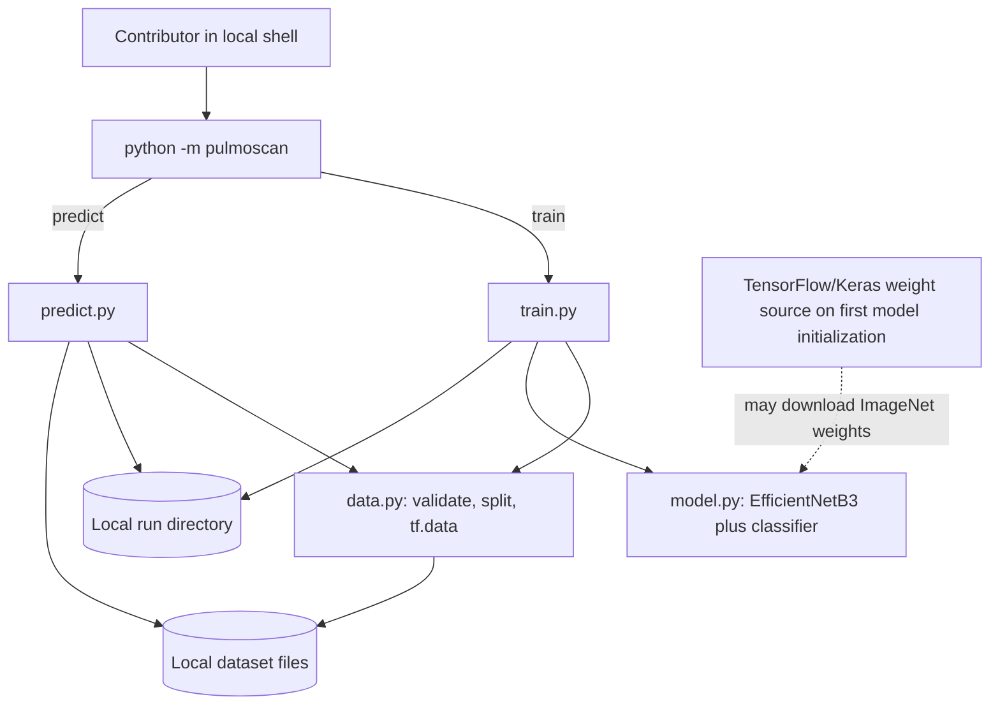

# PulmoScan: Project Overview

> **Status snapshot: 2026-11-01.** PulmoScan is an educational chest X-ray classification project with preserved Colab experiments and a maintained Python command-line training/inference pipeline. The implementation is present; a complete run, performance result, model checkpoint, and competition submission are not evidenced in this repository. It is not a medical device.

## Contents

- [At a glance](#at-a-glance)
- [Problem, thesis, and users](#problem-thesis-and-users)
- [Scope and limitations](#scope-and-limitations)
- [End-to-end workflow](#end-to-end-workflow)
- [Architecture](#architecture)
- [Technology stack](#technology-stack)
- [Repository map](#repository-map)
- [Implementation details](#implementation-details)
- [Design choices and parameter rationale](#design-choices-and-parameter-rationale)
- [Data contracts and artifacts](#data-contracts-and-artifacts)
- [CLI reference](#cli-reference)
- [Security, privacy, and responsible use](#security-privacy-and-responsible-use)
- [Operations and deployment](#operations-and-deployment)
- [Evaluation and evidence](#evaluation-and-evidence)
- [Original overview comparison](#original-overview-comparison)
- [History and current work](#history-and-current-work)
- [Setup and commands](#setup-and-commands)
- [Competition and presentation context](#competition-and-presentation-context)
- [Project skills and portfolio wording](#project-skills-and-portfolio-wording)
- [Source and evidence index](#source-and-evidence-index)

## At a glance

| Field | Details |
|---|---|
| Name | PulmoScan |
| Category | Educational computer vision / binary image classification |
| Purpose | Explore transfer learning to classify supplied chest X-ray PNGs as normal (`0`) or TB-positive (`1`), and create a reproducible local workflow for training, holdout evaluation, and batch inference. |
| Intended users | Contributors learning or demonstrating a machine-learning project; not patients or clinical operators. |
| Core model | ImageNet-initialized Keras EfficientNetB3 with a small sigmoid classification head. |
| Interface | Python package invoked with `python -m pulmoscan train` and `predict`. No web service or graphical application is included. |
| Current evidence | Code and docs exist. The workspace contains a 2,940-row label CSV, 1,309 training PNGs, and 1,260 test PNGs at this snapshot. The training copy is incomplete relative to the labels. No successful PulmoScan checkpoint, metrics artifact, test CSV, or submission is recorded. |
| Constraints | Python 3.10–3.11; TensorFlow 2.16.2; Linux, WSL2, or Colab recommended. Dataset and pretrained-weight terms are separate from the repository's MIT code license. |

PulmoScan takes a label table plus local image files, validates their relationship, splits labeled rows into training and validation subsets, resizes decoded images, trains a transfer-learning classifier, reports holdout metrics, and can apply a saved model to a directory of test PNGs. This describes implemented software behavior; it does not establish that a complete training run succeeded or that the model is clinically useful.

### Project thesis

A short notebook-based experiment is difficult to reproduce and difficult to assess when data paths, evaluation steps, and output artifacts are not explicit. PulmoScan preserves the original notebook history while providing a modular CLI pipeline with input checks, a seeded stratified split, fixed metric calculation, and named run artifacts. The evidence supports the presence of this pipeline; it does not support a claim of improved accuracy, a successful competition entry, or clinical validity.

## Problem, thesis, and users

### Problem framing

The project frames TB recognition from chest radiographs as binary image classification. Labels are supplied in `TB_train.csv`; the model learns a mapping from image pixels to a class-1 probability. The original supplied overview places the work in a CDIS/IIT Kanpur hackathon context. The repository's competition notes state that event rules and metric details were not independently confirmed from an accessible official rulebook.

### Users and use cases

| User | Goal | Supported workflow |
|---|---|---|
| ML learner or contributor | Understand and reproduce the experiment | Install the package, validate a local dataset copy, train, inspect validation outputs, and change documented CLI parameters. |
| Portfolio reviewer / technical presenter | Understand design and evidence | Read this overview alongside the architecture, results, model card, and competition provenance notes. |
| Competition participant | Produce a competition-format file from an authorized dataset and a trained model | Run `predict` to write sorted `ID,Target` predictions. The repository does not document a verified submission or leaderboard result. |
| Patient or clinician | Make a health decision | **Unsupported.** No clinical workflow, intended-use validation, or medical interface exists. |

A typical contributor workflow ends with local validation artifacts and optionally a test prediction file. A human must check the dataset source, competition terms, run configuration, output schema, and any competition submission process separately.

## Scope and limitations

### Implemented

- A Python package with `train` and `predict` CLI subcommands.
- CSV and labeled-image validation (required columns, nonempty labels, unique/non-null IDs, binary targets, both classes, and file existence).
- Seeded, stratified, image-level holdout splitting.
- PNG decode to three channels, resize, batching, optional training shuffle, and prefetch through `tf.data`.
- EfficientNetB3 transfer-learning model construction; frozen-head training and optional partial fine-tuning.
- Validation-loss checkpointing, early stopping, accuracy/precision/recall/F1 reporting, and per-image validation predictions.
- Test-directory inference that writes a two-column `ID,Target` CSV.
- Historical notebooks and documentation of provenance, data, risks, and absent results.

### Not implemented or not evidenced

- A hosted API, web/mobile UI, user accounts, authentication, database, cloud deployment, monitoring, or clinical integration.
- DICOM ingestion, patient-level data management, explainability maps, calibrated probabilities, a tuned decision threshold, class weighting, augmentation, or external validation.
- A complete experiment on the full labeled dataset, a saved final model, a verified submission, a score, or a leaderboard position.
- An automated test suite or CI workflow in the tracked file inventory.

The project is a reproducibility-oriented educational pipeline, not a deployed diagnostic product. Its validation split is image-level because patient identifiers are not available in the supplied contract; images from the same patient could therefore cross the split if the source data contains repeated patients. The current data snapshot has 1,309 training images for 2,940 labels, so training's deliberate missing-file check will stop before fitting.

## End-to-end workflow



The fit stages use validation loss to select weights. The default threshold (`0.5`) is applied afterward to calculate binary metrics; F1 does not choose the checkpoint or optimize the threshold. Prediction requires a previously saved model file and at least one PNG in the test directory. Invalid data fails early; training and prediction errors are surfaced through Python/TensorFlow exceptions rather than a retry or job-queue mechanism.

## Architecture

### Runtime components



This is a single-process local Python program, not a service topology. The filesystem is both the input boundary and the artifact store. There is no application database, message broker, external prediction service, or asynchronous worker. The only possible external runtime dependency beyond package installation is fetching ImageNet weights when Keras has no cached copy and `weights="imagenet"` is initialized.

### Module responsibilities

| Module | Actual responsibility |
|---|---|
| `src/pulmoscan/__main__.py` | Calls the CLI entry function for `python -m pulmoscan`. |
| `src/pulmoscan/cli.py` | Parses subcommands/options and validates threshold and validation-fraction ranges. |
| `src/pulmoscan/data.py` | Reads/validates labels, creates the stratified split, decodes images, and builds datasets. |
| `src/pulmoscan/model.py` | Constructs the EfficientNetB3 backbone and binary classification head. |
| `src/pulmoscan/train.py` | Seeds TensorFlow, fits both stages, compares phase checkpoints, computes metrics, and writes outputs. |
| `src/pulmoscan/predict.py` | Enumerates test PNGs, loads the model, predicts, thresholds, and writes the submission-format CSV. |

### Trust boundaries

The CLI accepts local paths and numeric options from its operator. CSV values and image files are treated as untrusted inputs and checked for the contracts implemented in `data.py`; the code does not deeply validate image provenance or patient identity. Model loading uses the selected local `.keras` file. Dataset contents, ImageNet source/weights, package dependencies, and competition submission systems are outside the program's authority. No credentials are required by the CLI, and no data is uploaded by the implementation.

## Technology stack

| Technology | Role |
|---|---|
| Python 3.10 / 3.11 | Runtime range set in `pyproject.toml`. |
| TensorFlow 2.16.2 / Keras | `tf.data`, EfficientNetB3, model fitting/loading, callbacks, and inference. |
| pandas | Read label CSVs and create validation/submission tables. |
| NumPy | Dataset arrays and prediction thresholding. |
| scikit-learn | Stratified splitting and accuracy, precision, recall, and F1 metrics. |
| setuptools / `pyproject.toml` | Package metadata and editable installation. |
| Git / notebooks | Source history and preserved Colab-era exploratory artifacts. |

No database, web framework, container build, deployment manifest, CI pipeline, logging/metrics backend, or experiment tracker appears in the tracked project files. GPU use is optional to the code; environment docs recommend Linux/WSL2/Colab, since the declared TensorFlow version is not supported for native Windows training.

## Repository map

```text
.
├── README.md                         # User-facing project entry point and quick start
├── CONTRIBUTING.md                   # Development constraints and contribution checklist
├── CHANGELOG.md                      # Unreleased repository changes
├── CITATION.cff                      # Software citation metadata
├── LICENSE                           # MIT terms for original project material
├── pyproject.toml                    # Package metadata, Python and dependency constraints
├── requirements.txt                  # Runtime dependencies
├── assets/pulmoscan-logo.svg         # Project logo
├── docs/
│   ├── architecture.md               # Components, contracts, checkpoint selection
│   ├── competition.md                # Provenance and account/API evidence notes
│   ├── data.md                       # Dataset layout, observed copy status
│   ├── licensing-and-citations.md    # Scope of code/data/weight licensing
│   ├── model-card.md                 # Intended use and model risks
│   ├── results.md                    # Evidence and absent performance result
│   ├── roadmap.md                    # Proposed future work
│   ├── training.md                   # Install, train, metrics, CLI options
│   └── source-materials/             # Archived overview and competition link
├── notebooks/
│   ├── README.md                     # Archive caveats
│   └── original/                     # Three supplied Colab notebooks
├── src/pulmoscan/                    # Maintained installable package
└── TB_Dataset/                       # Local data copy; contains sensitive-to-distribute data
```

`artifacts/` is an output convention, not a committed directory. It is ignored by `.gitignore`, as are model files, virtual environments, Kaggle credentials, and local `data/` paths. Dataset files currently present in `TB_Dataset/` are not covered by the MIT license; verify terms before redistribution.

## Implementation details

### Input checks and split

`load_labels()` reads `ID` and `Target`, selects only those columns (so other CSV columns are discarded), and checks: rows are nonempty; IDs are non-null and unique; targets parse numerically and are a subset of `{0,1}`; all referenced files exist under the training directory; and both classes are represented. It raises `ValueError` for schema/content failures and `FileNotFoundError` with a count and up to five example names for missing images.

The splitter uses `train_test_split(..., stratify=Target, random_state=seed)`. Defaults are 20% validation and seed 42. This is a reproducible image-level split, not a patient-level split. There is no duplicate-image/hash check or patient grouping.

### Image preprocessing

Each path is read by TensorFlow, decoded as a 3-channel PNG, resized to a square (default 224×224), and paired with a float label. Training data is shuffled with a fixed seed and reshuffled each epoch; validation/prediction data is not shuffled. Both are batched (default 32) and prefetched using `AUTOTUNE`. Keras EfficientNet's application preprocessing includes rescaling internally; this loader does not separately divide values by 255. No augmentation is applied in the maintained pipeline.

### Model and training

The model is `EfficientNetB3(include_top=False, weights="imagenet")`, initially frozen and called with `training=False`, followed by global average pooling, Dense(256, ReLU), Dropout(0.5), and Dense(1, sigmoid). The sigmoid output represents a model score/probability for class 1; it is not a calibrated clinical probability.

The head phase uses Adam at `1e-4`, binary cross-entropy, and binary accuracy. Fine tuning defaults to the final 100 backbone layers with Adam at `1e-5`; batch-normalization layers are explicitly kept non-trainable. Each phase monitors validation loss, saves its best checkpoint, and uses early stopping with patience 3 and restoration of best weights. If fine tuning runs, the two saved checkpoints are evaluated on the validation dataset and the lower-loss one becomes `best_model.keras`; the intermediate fine-tune file is removed. The loader does not add class weights or resampling despite the label imbalance documented in the data notes.

The effective training sequence is:

```mermaid
sequenceDiagram
    participant D as Validated training data
    participant M as Model
    participant V as Holdout validation data
    participant F as Run files
    D->>M: Fit new head; backbone frozen
    M->>V: Evaluate validation loss after epochs
    M->>F: Save best head checkpoint
    D->>M: Optionally fine-tune final backbone layers
    M->>V: Evaluate fine-tuning validation loss
    M->>F: Save best fine-tuned checkpoint
    F->>V: Compare phase checkpoints by loss
    V->>F: Write selected model, metrics, and per-image predictions
```

Early stopping and checkpointing address overfitting operationally by retaining lower-validation-loss weights and stopping after repeated non-improvement. They do not demonstrate generalization to a new hospital, scanner, population, or patient cohort.

### Metrics and prediction

After checkpoint selection, validation probabilities are thresholded with the configured threshold (default 0.5). Accuracy, precision, recall, and F1 are calculated with scikit-learn; zero predicted positives result in precision/recall/F1 values of zero where applicable via `zero_division=0`. `validation_metrics.json` includes split counts, configuration, threshold, metrics, and TensorFlow version. `validation_predictions.csv` includes `ID`, ground truth `Target`, `Probability`, and `Predicted`.

Prediction discovers files ending in `.png` (case-insensitive) in sorted path order, decodes/resizes them through the shared loader, loads the supplied model, thresholds outputs, creates the output parent directory, and writes `ID,Target`. It does not check that the model was trained with the same image-size argument, verify a competition template, upload the file, or include probabilities in the output.

The metric definitions used for interpretation are:

| Metric | Definition | What it describes here |
|---|---|---|
| Accuracy | `(TP + TN) / (TP + TN + FP + FN)` | Share of holdout images whose thresholded label matches the supplied target. It can obscure minority-class performance when labels are imbalanced. |
| Precision | `TP / (TP + FP)` | Of images predicted positive, the fraction labeled positive. |
| Recall / sensitivity | `TP / (TP + FN)` | Of labeled positive images, the fraction predicted positive. |
| F1 | `2 × precision × recall / (precision + recall)` | Harmonic mean of positive-class precision and recall. |
| Binary cross-entropy | Mean binary log loss between labels and sigmoid outputs | Training/checkpoint-selection objective; not the thresholded competition metric. |

Here, positive means the `Target=1` class in the supplied CSV. With no real completed run there are no PulmoScan metric values to interpret. A future result should state the split, threshold, dataset inventory, and run configuration beside every reported score.

## Data contracts and artifacts

### Expected local layout

```text
TB_Dataset/
├── TB_train.csv                  # Required columns: ID, Target
├── Training_Dataset_TB/          # Every CSV ID must resolve to a file here
│   └── TB_train_*.png
└── Test_Dataset_TB/
    └── TB_test_*.png
```

Class mapping is `0 = normal`, `1 = TB-positive`, as documented by project materials. The dataset notes report 2,940 label rows, with observed counts of 2,450 class 0 and 490 class 1. These are local/source-material observations, not an independently verified official dataset manifest. Image identities are filenames; patient identifiers, demographic fields, acquisition metadata, and data lineage are not represented in the training contract.

### Files written by a successful run

| File | Contents / use |
|---|---|
| `best_model.keras` | Selected checkpoint by minimum validation loss across executed phase(s). |
| `validation_metrics.json` | Threshold, counts, metrics, config, TensorFlow version. |
| `validation_predictions.csv` | Per-validation image truth, probability, and thresholded label. |
| `submission.csv` (or chosen output path) | Test image filenames and integer predictions with exact columns `ID,Target`. |

These are local filesystem artifacts, not immutable evidence stores. Runs can overwrite files when they reuse a directory. There is no run registry or built-in provenance checksum for the input data.

### Example output contracts

The competition-shaped output is intentionally minimal:

```csv
ID,Target
TB_test_0001.png,0
TB_test_0002.png,1
```

The validation file is richer because it is intended for inspection rather than direct upload:

```csv
ID,Target,Probability,Predicted
TB_train_0007.png,1,0.73,1
TB_train_0012.png,0,0.18,0
```

These rows illustrate the implemented column contract only; values are examples, not measured outputs from this project.

## CLI reference

Both commands require the installed dependencies and local input files. Neither command authenticates a user or calls a hosted PulmoScan service.

### Train

```bash
python -m pulmoscan train --data-dir TB_Dataset --output-dir artifacts/run-001
```

| Option | Default | Effect |
|---|---:|---|
| `--data-dir` | `TB_Dataset` | Root used to derive default CSV and image directories. |
| `--train-dir` | `<data-dir>/Training_Dataset_TB` | Override labeled-image directory. |
| `--labels` | `<data-dir>/TB_train.csv` | Override label CSV. |
| `--output-dir` | `artifacts/run-001` | Directory for checkpoints and validation files. |
| `--image-size` | `224` | Square resize dimension. |
| `--batch-size` | `32` | Batch size. |
| `--seed` | `42` | TensorFlow seed, split seed, and train shuffle seed. |
| `--threshold` | `0.5` | Validation classification threshold; must be strictly between 0 and 1. |
| `--validation-fraction` | `0.2` | Stratified holdout proportion; must be strictly between 0 and 1. |
| `--epochs-head` | `10` | Maximum head-only epochs. |
| `--epochs-fine` | `10` | Maximum additional fine-tuning epochs; set to 0 to skip fine tuning. |
| `--fine-tune-layers` | `100` | Number of final backbone layers eligible for unfreezing. |
| `--learning-rate-head` | `1e-4` | Adam learning rate for head stage. |
| `--learning-rate-fine` | `1e-5` | Adam learning rate for fine tuning. |
| `--dropout` | `0.5` | Classifier dropout rate. |

### Predict

```bash
python -m pulmoscan predict --model artifacts/run-001/best_model.keras --data-dir TB_Dataset --output artifacts/run-001/submission.csv
```

| Option | Default | Effect |
|---|---:|---|
| `--model` | Required | Saved Keras model to load. |
| `--data-dir` | `TB_Dataset` | Root used for default test directory. |
| `--test-dir` | `<data-dir>/Test_Dataset_TB` | Override test-image directory. |
| `--output` | `artifacts/submission.csv` | CSV output path; parent directories are created. |
| `--image-size`, `--batch-size`, `--seed`, `--threshold` | `224`, `32`, `42`, `0.5` | Input pipeline and threshold settings. |

`python -m pulmoscan train --help` and `python -m pulmoscan predict --help` print parser help. The CLI checks threshold/fraction bounds; other semantic constraints such as positive batch size and fine-tune layer count are not comprehensively validated before TensorFlow execution.

## Security, privacy, and responsible use

- **Medical boundary:** outputs are educational predictions only. They must not be used for diagnosis, screening, triage, treatment, or care decisions. The model is not clinically validated, externally evaluated, calibrated, or cleared for clinical use.
- **Data boundary:** the repository documentation identifies competition data as separately governed. Do not assume the MIT license grants dataset or patient-image redistribution rights. Confirm authorized access and terms.
- **Privacy:** the CLI performs local file reads/writes and has no built-in network upload, authentication, user profiles, or telemetry. The first EfficientNet initialization may download pretrained weights. Do not place identifiable patient data in a public repository or logs.
- **Secrets:** `.gitignore` excludes `kaggle.json`, `.env`, and key files. No secret is needed by the package. Do not commit competition credentials.
- **Input integrity:** the CSV checks protect basic structural assumptions, but do not establish image provenance, safe clinical content, label correctness, or freedom from dataset leakage.
- **Authority:** this software can create local model and CSV files only. It has no authority to make a medical decision or submit to Kaggle automatically.

## Operations and deployment

There is no deployed service, health/readiness endpoint, request authentication, observability stack, scheduled retraining, rollback system, or release automation documented in the repository. Operation is a local command invocation. The operator chooses input paths/output directories; a completed training process writes files under the run directory. To recover from interruption, rerun with an output directory and configuration of choice; there is no resume-from-checkpoint workflow exposed by the CLI. Checkpointing is for best validation loss within a run, not a full experiment-management or deployment rollout system.

## Evaluation and evidence

### Evaluation design and limits

The current evaluation is a single stratified random holdout from the labeled image rows. Stratification approximately preserves the class distribution in both subsets, but it does not substitute for grouped or external validation. The fixed seed makes row assignment reproducible for a stable CSV ordering/version and library behavior; it does not guarantee bit-for-bit GPU determinism. Reusing this holdout repeatedly to tune many choices can also make it less independent as an estimate of future performance.

Validation loss selects the weights, and a fixed threshold converts predicted scores to labels. The code does not search for a best F1 threshold, calculate a confidence interval, produce a confusion matrix, compare subgroups, or measure calibration. Those are reasonable future evaluation tasks, not current outputs.

### What is implemented vs. what is measured

| Item | Evidence status as of 2026-11-01 |
|---|---|
| Maintained model/data/train/predict code | Present in `src/pulmoscan/`. |
| Original experiment approach | Three Colab-oriented notebooks contain model/training code and partial outputs. |
| Labels | 2,940 rows observed in local CSV; distribution documented as 2,450/490. |
| Training image coverage | 1,309 files currently present out of 2,940 referenced rows; 1,631 are missing at snapshot time. |
| Test images | 1,260 PNGs present at snapshot time. |
| Complete pipeline run | Not evidenced; missing training images cause the loader to stop. |
| Automated project tests / CI | No test directory or CI workflow appears in tracked files. No test suite was run for this documentation task. |
| Saved PulmoScan model / validation metrics | Not found/documented. |
| Competition submission / personal score | Competition notes report no submission for the connected account in the 2026-11-01 check; no PulmoScan score or rank is claimed. |

The notebooks preserve a stale `KeyError: 'class'` traceback in an otherwise empty cell in two copies, according to the notebook/provenance notes. It is historical notebook output, not evidence of a passing or current CLI run. Public leaderboard entries are not evidence for this project's model.

## Original overview comparison

The supplied long-form overview is useful as a record of the initial hackathon framing and intended notebook method. It was compared with the current package, repository docs, and notebook archive before preparing this dossier. The following reconciliation keeps historical details distinct from current implementation:

| Topic | Supplied overview | Current evidence used here |
|---|---|---|
| Product framing | Calls the project an automated TB diagnosis/screening system. | Repository model card limits intended use to education and portfolio demonstration; no clinical use is supported. |
| Primary environment | Describes Colab, Drive mounting, and notebook execution. | Those belong to the preserved original notebooks. The maintained workflow is a local Python CLI targeting Linux, WSL2, or Colab. |
| Preprocessing | Describes notebook `ImageDataGenerator`, `/255` rescaling, and a validation split. | Current `tf.data` pipeline decodes RGB PNGs and resizes; Keras EfficientNet performs its built-in rescaling, so the maintained loader does not separately divide by 255. |
| Fine-tuning duration | Describes the notebook's 10 head epochs plus nominal 10 fine-tuning epochs. | Current CLI defaults match those maxima, but early stopping can end earlier; fine tuning can be disabled. Notebook code and CLI behavior are not interchangeable. |
| Evaluation | Presents F1 as competition primary metric and recall as tie-breaker. | This is attributed to supplied notes; accessible official rules were not confirmed. The code reports F1/recall but does not optimize them or verify the official scoring rule. |
| Dataset counts | States 2,940 training and 1,260 test images. | 2,940 CSV rows and 1,260 test files are documented/observed; the current training image directory has only 1,309 files. These are not a complete verified dataset manifest. |
| Results | Uses aspirational language about a robust/strong solution and improved benchmark. | No complete run, score, saved model, or submission is documented. This dossier makes no performance claim. |
| Competition participation | Gives competition dates, allowed methods, and late-submission context. | These are historical supplied claims. Check `competition.md`; official dates/rules were not independently verified in the repository evidence. |

The reference also contains a dataset-access command and a hard-coded password. Neither is reproduced here. Follow authorized data access instructions from the current provider and never place credentials in project documentation. The archived in-repository source overview is described as sanitized in `competition.md`.

## Design choices and parameter rationale

The table explains the current defaults and their practical role. These are implementation choices documented in the repository, not evidence that the values are optimal.

| Choice | Default | Why it is present | Trade-off / evidence limit |
|---|---:|---|---|
| EfficientNetB3 with ImageNet weights | B3 | Reuses pretrained visual features and keeps the experiment focused on transfer learning. | Domain and dataset suitability have not been measured against alternative backbones. Weight download/licensing is upstream. |
| Input dimensions | `224 × 224` | Standardized tensor dimensions for batching and model input. | Resizing can alter fine image detail; the project has no resolution ablation. |
| Batch size | `32` | Practical minibatch default in the maintained pipeline and original notes. | Memory use depends on runtime/GPU; no batch-size benchmark is recorded. |
| Head | GAP → Dense 256 ReLU → Dropout 0.5 → sigmoid | Converts spatial backbone features into one binary score with a compact learned classifier. | No architecture comparison or calibration study exists. |
| Loss | Binary cross-entropy | Trains a single sigmoid output against binary labels. | This loss is not the same quantity as F1 or the purported competition score. |
| Optimizer | Adam | Adaptive optimizer used in both training phases. | No optimizer comparison is recorded. |
| Head learning rate | `1e-4` | Default for fitting newly initialized classifier layers while features remain frozen. | A documented starting point, not a tuned optimum. |
| Fine-tuning learning rate | `1e-5` | Lower update size while adapting pretrained backbone weights. | Fine tuning is optional and may not improve holdout loss. |
| Fine-tuned layers | Last `100` | Limits how much of the pretrained representation is updated. | Layer count is a heuristic and is not validated experimentally here. |
| Batch normalization | Frozen during fine tuning | Avoids updating moving statistics from a relatively small dataset. | This is a stability choice; its effect has not been measured. |
| Dropout | `0.5` | Regularizes the dense classifier head. | No dropout ablation is available. |
| Validation fraction / seed | `0.2` / `42` | Produces a reproducible stratified holdout. | Image-level split can leak patient-specific traits if patient repeats exist. |
| Classification threshold | `0.5` | Converts score to a binary class using `score >= threshold`. | The threshold is not calibrated or tuned to a clinical/competition cost function. |
| Early stopping | patience `3`, validation loss | Stops a phase after repeated lack of loss improvement and restores best weights. | The metric being monitored may not align with F1 or recall. |

The supplied overview's original notebook used `ImageDataGenerator` and additional rescaling. Those notebook choices must not be attributed to the maintained CLI pipeline, whose input path is defined in `data.py` and `model.py`.

## History and current work

The repository records an original Colab/hackathon phase followed by a maintained Python package that separates data validation, model construction, training, evaluation, and prediction. The original supplied overview describes the EfficientNetB3 approach and event context; it is retained as source material, not treated as authoritative evidence of successful execution. The current package adds explicit validation and output generation that are absent or incomplete in the archived notebooks.

The changelog lists these as unreleased repository changes; it does not imply a tagged or published release. The current project snapshot is on the repository's `main` branch, with no working-tree changes reported before this documentation was created.

### Next steps from the project roadmap

Official roadmap items are proposals, not completed work:

1. Complete and inventory the authorized training data; confirm every CSV ID maps to one image.
2. Confirm official competition metric, schema, data use terms, and availability of patient identifiers.
3. Run the maintained baseline and save configuration, metrics, predictions, and dataset provenance.
4. Inspect confusion matrix and threshold trade-offs; compare a small set of baselines on the same split.
5. Add lightweight automated checks for input validation and submission schema.

## Setup and commands

### Prerequisites

Python 3.10 or 3.11 and a Linux, WSL2, or Google Colab environment are the documented target. TensorFlow 2.16.2 is pinned. A GPU can accelerate training but is not required by the source. An initial model build may need network access to obtain ImageNet weights. Confirm local storage is sufficient for the dataset, TensorFlow environment, cached weights, and run outputs.

### Install

Linux / WSL2 shell:

```bash
python3.11 -m venv .venv
source .venv/bin/activate
python -m pip install --upgrade pip
pip install -e .
```

PowerShell virtual environment activation differs (`.venv\Scripts\Activate.ps1`), but native Windows training is not the documented TensorFlow 2.16 target; use WSL2 or Colab for the supported environment.

### Train and infer

```bash
python -m pulmoscan train --data-dir TB_Dataset --output-dir artifacts/run-001
python -m pulmoscan predict --model artifacts/run-001/best_model.keras --data-dir TB_Dataset --output artifacts/run-001/submission.csv
```

The train command will currently fail its all-labels-present check because this workspace has 1,309 of 2,940 training images. Do not treat the commands above as a verified successful run. For a different dataset layout, provide `--train-dir`, `--labels`, and/or `--test-dir` explicitly.

### Configuration and secrets

Runtime options are CLI arguments shown in the reference above; there are no application environment variables. Kaggle credentials may be needed for a separate authorized data-download workflow, but are not consumed by PulmoScan itself. Keep such credentials out of source control. `requirements.txt` mirrors the runtime packages declared in `pyproject.toml`.

## Competition and presentation context

The supplied materials associate the project with “Tuberculosis Detection from Chest X-Rays,” attributed to CDIS, IIT Kanpur, with a Kaggle competition URL. They also state 2,940 labeled training images, 1,260 test images, and F1 with recall as a tie-breaker. The repository explicitly marks those competition facts as not fully verified against accessible official files/rules. Treat them as source-material claims until confirmed independently.

For a technical presentation, a well-supported narrative is: *PulmoScan began as a notebook transfer-learning experiment and was organized into a local, modular pipeline for validating data, training an EfficientNetB3 classifier, reporting holdout metrics, and generating a competition-shaped CSV. The repository documents the intended method and the current data/evidence gaps; it does not report a verified score.* Avoid phrases such as “diagnoses TB,” “clinically accurate,” or “outperformed the baseline” unless future independent evidence supports a changed claim.

### Requirements-to-implementation map

The supplied competition overview describes expectations, but the official rule set was not independently verified. This map is therefore a project-material mapping, not a compliance certification.

| Stated project/competition need | Repository implementation or evidence | Current qualification |
|---|---|---|
| Binary prediction from chest X-rays | EfficientNetB3 plus sigmoid in `model.py`; labels checked in `data.py`. | Implemented in source; not evaluated on a complete dataset. |
| Respect CSV labels and image IDs | `load_labels()` validates required columns, unique IDs, binary labels, and referenced files. | Implemented for the documented CSV contract. |
| Create a reproducible holdout | Stratified split with configurable seed and fraction. | Image-level; patient-level independence is unknown. |
| Report classification performance | Accuracy, precision, recall, F1 and per-image probabilities. | Implemented; no actual score is present. |
| Produce competition-shaped test output | `predict` writes `ID,Target`. | Writer is implemented; no output from a successful run or submission is recorded. |
| Use the event's official evaluation metric/schema | Supplied notes say F1 and recall tie-break and claim `ID,Target`. | Verify against current official rules before submission; no official accessible rulebook is preserved. |
| Demonstrate a competitive result | No verified model result, personal submission, or score artifact. | Not established. |

### Portfolio and skills summary

The source tree supports describing the work as experience with Python package organization, TensorFlow/Keras transfer learning, image input pipelines, binary classification, stratified validation, metric reporting, CLI design, and reproducibility documentation. It does **not** support claims of clinical AI deployment, Kaggle ranking, model accuracy, production operations, or benchmark improvement. For a resume or portfolio, describe concrete implementation contributions and omit performance claims until a complete run and independent evidence exist.

## Source and evidence index

| Topic | Source |
|---|---|
| User-facing summary and quick start | [`README.md`](../README.md) |
| Contributor constraints | [`CONTRIBUTING.md`](../CONTRIBUTING.md) |
| Architecture and checkpoint policy | [`architecture.md`](architecture.md) |
| Dataset format and copy snapshot | [`data.md`](data.md) |
| Training options and artifacts | [`training.md`](training.md) |
| Current results/evidence boundary | [`results.md`](results.md) |
| Intended use and model risks | [`model-card.md`](model-card.md) |
| Competition provenance and account check | [`competition.md`](competition.md) |
| Data/code/weight license scope | [`licensing-and-citations.md`](licensing-and-citations.md) |
| Proposed work | [`roadmap.md`](roadmap.md) |
| Original notebook caveats | [`notebooks/README.md`](../notebooks/README.md) |
| Historical overview supplied with project | [`PulmoScan-Project-Overview-original.md`](source-materials/PulmoScan-Project-Overview-original.md) |
| Package/dependency contract | [`pyproject.toml`](../pyproject.toml), [`requirements.txt`](../requirements.txt) |
| Data validation and input pipeline | [`src/pulmoscan/data.py`](../src/pulmoscan/data.py) |
| Model architecture | [`src/pulmoscan/model.py`](../src/pulmoscan/model.py) |
| Training, callbacks, evaluation | [`src/pulmoscan/train.py`](../src/pulmoscan/train.py) |
| Batch prediction and CSV output | [`src/pulmoscan/predict.py`](../src/pulmoscan/predict.py) |
| CLI parameters and validation | [`src/pulmoscan/cli.py`](../src/pulmoscan/cli.py) |
| Change history and release state | [`CHANGELOG.md`](../CHANGELOG.md), [`CITATION.cff`](../CITATION.cff) |

---

This overview was prepared from the repository contents and local workspace state on 2026-11-01. Dataset counts and external competition/account observations are time-bound; consult the cited evidence documents for their provenance and limits.
