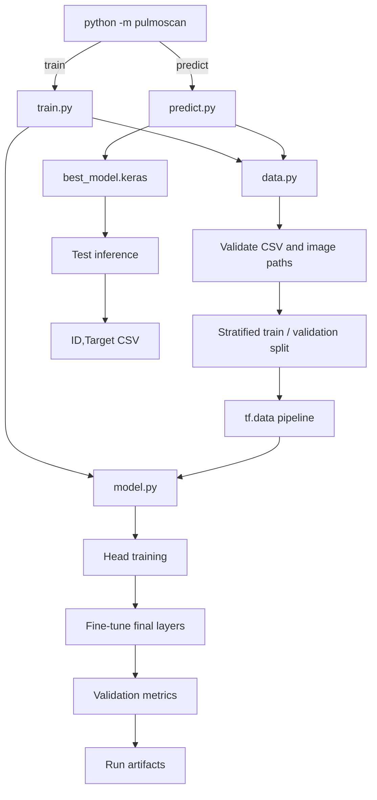

# System architecture

PulmoScan separates file validation, image input, model construction, training and prediction. The CLI is the entry point; the reusable implementation lives in `src/pulmoscan/`.

## Application flow

## Components

| Module | Responsibility |
|---|---|
| `cli.py` | Defines `train` and `predict` subcommands and command-line defaults |
| `data.py` | Reads and validates the label table, creates the stratified split, decodes PNGs and builds `tf.data` pipelines |
| `model.py` | Builds the EfficientNetB3 backbone and binary classification head |
| `train.py` | Runs the frozen and fine-tuning stages, selects the validation-loss checkpoint, and writes metrics/predictions |
| `predict.py` | Loads a saved model and creates a test prediction CSV |
| `__main__.py` | Makes `python -m pulmoscan` invoke the CLI |

## Data contracts

### Training inputs

- `TB_train.csv` has exactly the required columns `ID` and `Target` (extra columns are ignored).
- `ID` identifies a PNG under the training image directory and must be unique.
- `Target` is binary: `0` for normal and `1` for TB-positive.
- Every labeled image must exist. The pipeline fails early with a sample of missing filenames if the copy is incomplete.

### Inference inputs and outputs

- Test PNGs are enumerated in filename order from the test directory.
- The saved model returns a probability for class `1`.
- The configured threshold (default `0.5`) converts probabilities to integer labels.
- The output CSV has the two columns `ID,Target`.

## Image and model path

Images are decoded as three-channel PNGs and resized to 224 × 224. The TensorFlow/Keras EfficientNetB3 application includes its own input rescaling, so the maintained loader does not divide decoded values by 255 a second time. The classifier head is global average pooling, Dense(256, ReLU), Dropout(0.5), and Dense(1, sigmoid).

## Checkpoint selection

The head stage and fine-tuning stage each checkpoint their best validation-loss model. If fine-tuning is enabled, their validation losses are compared and `best_model.keras` is left as the better checkpoint. Validation loss selects the saved weights; F1 is reported at the fixed prediction threshold and does not currently select either the checkpoint or threshold.
